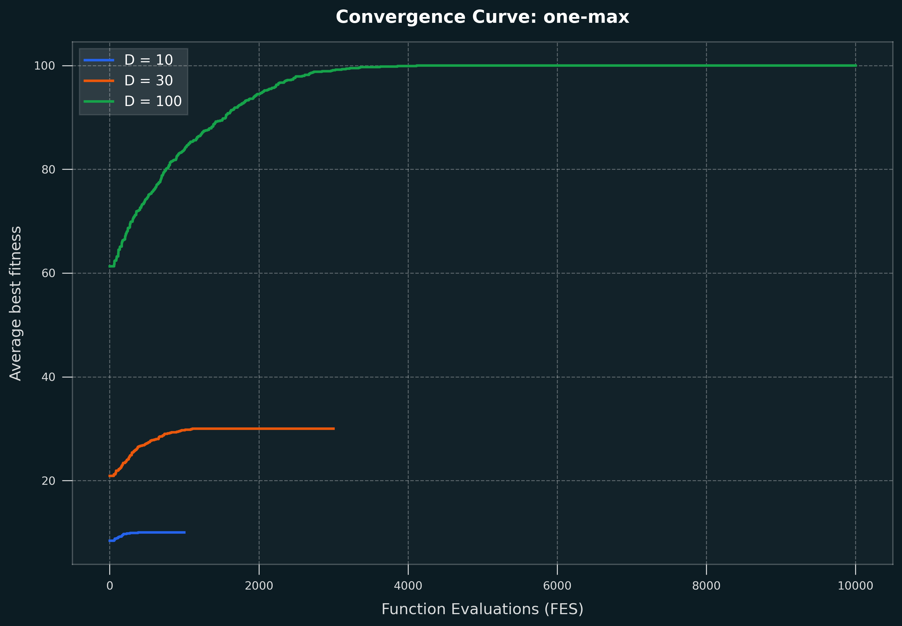
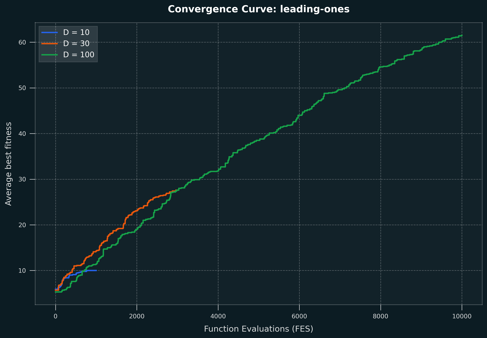

# Binary Genetic Algorithm

This project implements a genetic algorithm for binary optimization problems. It supports the **One-Max** and **LeadingOnes** benchmark problems and evaluates the algorithm for binary strings of dimensions 10, 30, and 100.

The implementation uses:

- Binary chromosomes
- Elitism
- Rank or roulette-wheel parent selection
- Single-point or uniform crossover
- Bitwise mutation
- Reproducible pseudo-random seeds
- Average best-so-far convergence plots
- Summary statistics over multiple independent runs

## Project Structure

```text
.
├── main.py                          # Main experiment runner and genetic algorithm
├── cli.py                           # Command-line argument parsing and validation
├── visualization.py                 # Convergence plot generation
├── results.ipynb                    # Documented experimental results
├── results.json                     # Saved experiment results
└── img/
    └── convergence/
        ├── convergence_one-max.png  # One-Max average convergence plot
        └── convergence_leading-ones.png
                                       # LeadingOnes average convergence plot
```

## Benchmark Problems

### One-Max

One-Max maximizes the number of ones in the chromosome:

```text
f(x) = sum(x_i)
```

For a chromosome of dimension `D`, the global optimum is `D`.

### LeadingOnes

LeadingOnes maximizes the number of consecutive ones from the beginning of the chromosome. The objective stops counting at the first zero.

Examples:

```text
111010 -> 3
111111 -> 6
010111 -> 0
```

For a chromosome of dimension `D`, the global optimum is also `D`.

## Genetic Algorithm

Each run starts with a randomly generated population of binary chromosomes. Every subsequent generation is constructed as follows:

1. The best individuals are copied directly to the next population according to the elitism ratio.
2. Two parents are selected using the configured selection method.
3. The parents undergo crossover with the configured crossover probability.
4. Each offspring is mutated bit by bit.
5. The new population is evaluated and the best-so-far fitness is recorded.

The default configuration follows the assignment recommendations:

| Parameter | Default |
|---|---:|
| Population size | 50 |
| Elitism ratio | 0.10 |
| Crossover ratio | 0.90 |
| Mutation probability | 0.01 per bit |
| Selection | Rank selection |
| Crossover | Single-point |
| Independent runs | 10 |
| Dimensions | 10, 30, 100 |
| Evaluation budget | `100 × D` |
| Random seed | 77777 |

## Usage

### Run the default experiment

```bash
python main.py
```

The default command runs both benchmark problems for dimensions 10, 30, and 100, prints summary statistics, and generates convergence plots.

### Save results to JSON

```bash
python main.py --save-results
```

This writes the detailed experiment data to `results.json`, including:

- The evaluation budget for each dimension
- Best, worst, mean, median, and standard deviation
- The average best-so-far convergence trace

### Run only one problem

```bash
python main.py --problem one-max
python main.py --problem leading-ones
```

### Run custom dimensions and number of runs

```bash
python main.py -d 10 30 100 -n 30
```

## Available CLI Arguments

- `-p, --problem` - Problem to solve: `one-max`, `leading-ones`, or `all`. Default: `all`
- `-n, --n-runs` - Number of independent runs per configuration. Default: `10`
- `-d, --dimensions` - Binary string dimensions to test. Default: `10 30 100`
- `-m, --max-fes-multiplier` - Objective evaluations per dimension. Default: `100`
- `-s, --seed` - Base random seed. Default: `77777`
- `--population-size` - Number of chromosomes in the population. Default: `50`
- `--elitism-ratio` - Fraction of the best population copied to the next generation. Default: `0.10`
- `--crossover-ratio` - Probability that selected parents undergo crossover. Default: `0.90`
- `--mutation-probability` - Probability of flipping each chromosome bit. Default: `0.01`
- `--selection` - Parent selection method: `rank` or `roulette`. Default: `rank`
- `--crossover` - Crossover operator: `single-point` or `uniform`. Default: `single-point`
- `--no-plots` - Skip generating convergence plots
- `--save-results` - Save detailed results to `results.json`

Run the following command to display all arguments and their defaults:

```bash
python main.py -h
```

## Example Output

The following output was produced using the default configuration:

```text
one-max       D= 10 | best=10.00 | worst=10.00 | mean=10.00 | median=10.00 | stddev=0.00
one-max       D= 30 | best=30.00 | worst=30.00 | mean=30.00 | median=30.00 | stddev=0.00
one-max       D=100 | best=100.00 | worst=100.00 | mean=100.00 | median=100.00 | stddev=0.00
leading-ones  D= 10 | best=10.00 | worst=10.00 | mean=10.00 | median=10.00 | stddev=0.00
leading-ones  D= 30 | best=30.00 | worst=19.00 | mean=27.60 | median=30.00 | stddev=3.72
leading-ones  D=100 | best=78.00 | worst=54.00 | mean=61.50 | median=60.50 | stddev=6.57
Saved: results.json
Saved: img\convergence\convergence_one-max.png
Saved: img\convergence\convergence_leading-ones.png
```

## Convergence Results

The plots show the average best-so-far fitness over the independent runs. The horizontal axis is the number of function evaluations (FES), while the vertical axis is the average best fitness.

### One-Max



One-Max reaches the theoretical optimum for all tested dimensions. The curves become horizontal after convergence because the best-so-far fitness cannot decrease. The 100-dimensional case takes more evaluations to reach its optimum, but still converges before the 10,000-FES budget ends.

### LeadingOnes



LeadingOnes is more difficult because only the consecutive prefix of ones contributes to the fitness. The curves therefore contain plateaus and staircase-like improvements. The 100-dimensional case reaches an average fitness of approximately 61.5 and does not consistently reach the optimum within its 10,000-FES budget.

## Results Summary

| Problem | Dimension | Best | Worst | Mean | Median | Standard deviation |
|---|---:|---:|---:|---:|---:|---:|
| One-Max | 10 | 10 | 10 | 10.00 | 10.00 | 0.00 |
| One-Max | 30 | 30 | 30 | 30.00 | 30.00 | 0.00 |
| One-Max | 100 | 100 | 100 | 100.00 | 100.00 | 0.00 |
| LeadingOnes | 10 | 10 | 10 | 10.00 | 10.00 | 0.00 |
| LeadingOnes | 30 | 30 | 19 | 27.60 | 30.00 | 3.72 |
| LeadingOnes | 100 | 78 | 54 | 61.50 | 60.50 | 6.57 |

The results show that the default configuration is highly reliable for One-Max, where all bits contribute independently. LeadingOnes is less separable and more sensitive to the order of the bits, so its performance decreases as the dimension grows.