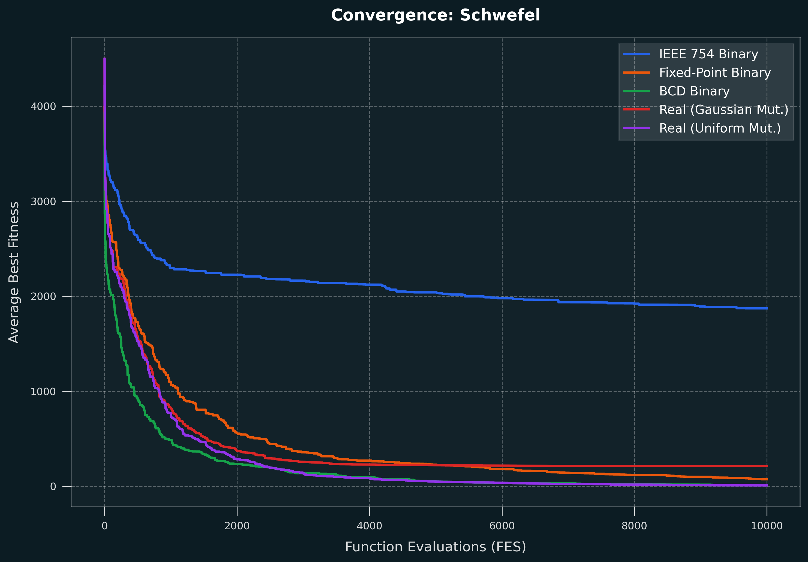
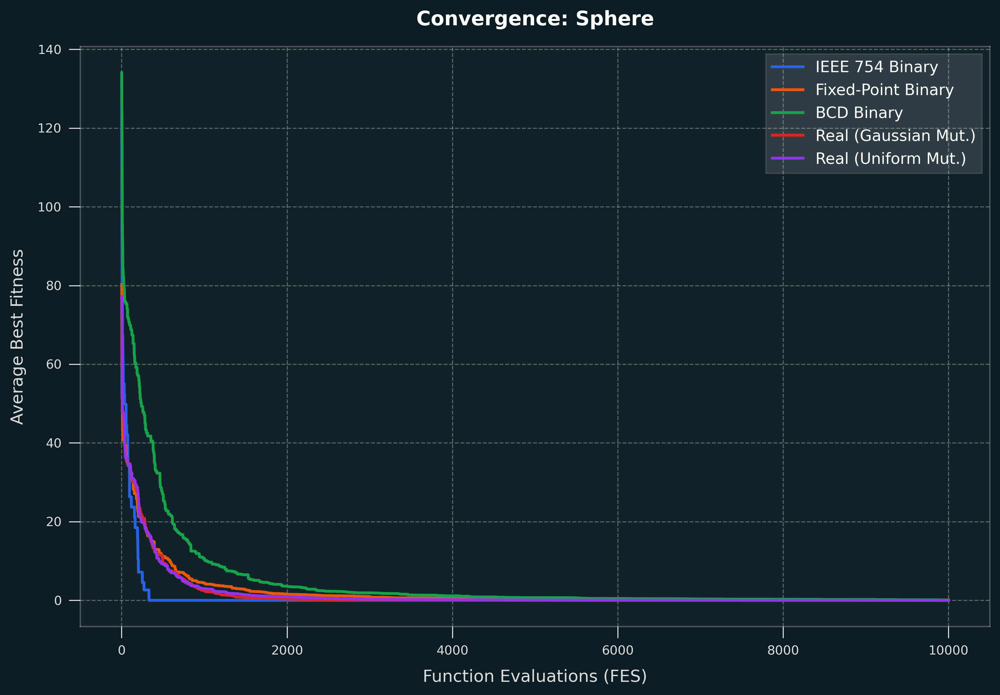
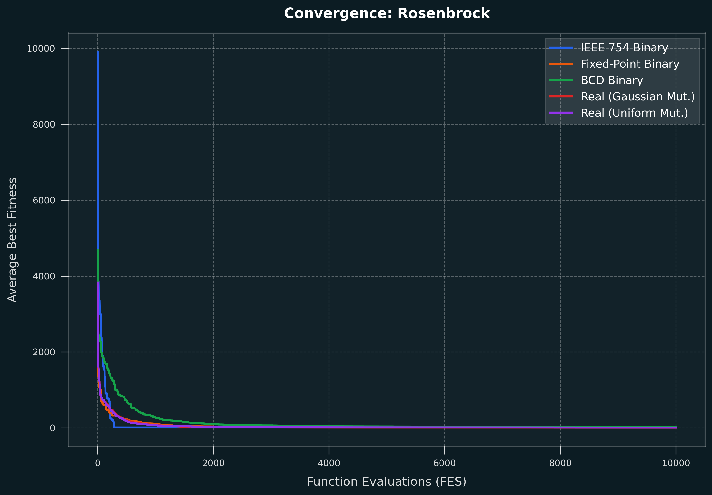

# Real-Valued Genetic Algorithm

This project implements a genetic algorithm for optimization problems with real-valued parameters. It compares binary encoding methods (IEEE 754, Fixed-Point, and BCD) with direct real-valued representations (Gaussian mutation and uniform random mutation) on the **Schwefel**, **Sphere**, and **Rosenbrock** benchmark functions in 10 dimensions.

The implementation uses:

- Binary encodings: IEEE 754, Fixed-Point, BCD (32 bits per dimension)
- Real-valued representations: Gaussian mutation and uniform random mutation
- Elitism
- Tournament parent selection
- Single-point crossover
- Reproducible pseudo-random seeds
- Average best-so-far convergence plots
- Summary statistics over multiple independent runs

## Project Structure

```text
.
├── main.py                          # Main experiment runner and genetic algorithm
├── results.ipynb                    # Documented experimental results
├── results.json                     # Saved experiment results
├── modules/
│   ├── __init__.py                  # Package exports and function mapping
│   ├── benchmark_functions.py       # Benchmark optimization functions
│   ├── cli.py                       # Command-line argument parsing and validation
│   ├── ga_engine.py                 # Core GA engine with binary and real-valued variants
│   └── visualization.py             # Convergence plot generation
└── img/
    └── convergence/
        ├── convergence_schwefel.png    # Schwefel average convergence plot
        ├── convergence_sphere.png      # Sphere average convergence plot
        └── convergence_rosenbrock.png  # Rosenbrock average convergence plot
```

## Benchmark Problems

All benchmark problems are formulated as minimization tasks: `min f(x)`.

Benchmark functions available in `modules/benchmark_functions.py`: **Schwefel**, **Sphere**, **Rosenbrock** **Rastrigin**, **Ackley**, **Zakharov**, and **Michalewicz**.

## Genetic Algorithm

Each run starts with a randomly generated population. Every subsequent generation is constructed as follows:

1. The best individuals are copied directly to the next population according to the elitism ratio.
2. Two parents are selected using tournament selection.
3. The parents undergo crossover with the configured crossover probability.
4. Each offspring is mutated according to the selected representation variant.
5. The new population is evaluated and the best-so-far fitness is recorded.

The default configuration follows the assignment recommendations:

| Parameter | Default |
|---|---:|
| Population size | 100 |
| Elitism ratio | 0.10 |
| Crossover ratio | 0.90 |
| Mutation probability | 0.05 |
| Selection | Tournament (size 3) |
| Crossover | Single-point |
| Independent runs | 10 |
| Dimensions | 10 |
| Evaluation budget | 10,000 FES |
| Random seed | 42 |

### Algorithm Variants

- **IEEE 754 Binary** (`ieee754`): Encodes each dimension as a 32-bit single-precision float (1 sign bit, 8 exponent bits, 23 mantissa bits). Single-point bit crossover and bit-flip mutation.
- **Fixed-Point Binary** (`fixed_point`): Linear integer mapping to `[0, 2^32 - 1]` with uniform resolution. Single-point bit crossover and bit-flip mutation.
- **BCD Binary** (`bcd`): 8 decimal digits (4 bits per digit = 32 bits/dim) with repair clamping invalid nibbles (10-15) to 9.
- **Real-Valued Gaussian** (`real_gaussian`): Single-point crossover between dimension boundaries + Gaussian perturbation `x_i + N(0, sigma^2)` clamped to bounds.
- **Real-Valued Uniform** (`real_uniform`): Single-point crossover between dimension boundaries + uniform random replacement from the entire search range.

## Usage

### Run the default experiment

```bash
python main.py
```

The default command runs all 5 variants on Schwefel, Sphere, and Rosenbrock (10D, 10,000 FES, 10 runs), prints summary statistics, and generates convergence plots.

### Save results to JSON

```bash
python main.py --save-results
```

This writes the detailed experiment data to `results.json`, including:

- Best, worst, mean, median, and standard deviation for each configuration
- The average best-so-far convergence trace over 10 independent runs

### Run specific functions or variants

```bash
python main.py -f sphere rosenbrock
python main.py -v real_gaussian real_uniform
python main.py -f rastrigin ackley -v ieee754 fixed_point
```

### Run custom parameters

```bash
python main.py -d 10 -n 20 --max-fes 15000 --population-size 150
```

## Available CLI Arguments

- `-f, --functions` - Benchmark functions to test: `schwefel`, `sphere`, `rosenbrock`, `rastrigin`, `ackley`, `zakharov`, `michalewicz`, or `all`. Default: `schwefel sphere rosenbrock`
- `-v, --variants` - GA variants to test: `ieee754`, `fixed_point`, `bcd`, `real_gaussian`, `real_uniform`, or `all`. Default: `all`
- `-n, --n-runs` - Number of independent runs per configuration. Default: `10`
- `-d, --dimension` - Search space dimensionality. Default: `10`
- `--max-fes` - Maximum objective evaluations per run. Default: `10000`
- `-s, --seed` - Base random seed. Default: `42`
- `--population-size` - Number of chromosomes in the population. Default: `100`
- `--elitism-ratio` - Fraction of the best population copied to the next generation. Default: `0.10`
- `--crossover-ratio` - Probability that selected parents undergo crossover. Default: `0.90`
- `--mutation-probability` - Mutation probability (per bit for binary, per dimension for real). Default: `0.05`
- `--tournament-size` - Tournament selection contestant count. Default: `3`
- `--sigma` - Standard deviation for Gaussian mutation as fraction of search range. Default: `0.10 * range`
- `--no-plots` - Skip generating convergence plots
- `--save-results` - Save detailed results to `results.json`

Run the following command to display all arguments and their defaults:

```bash
python main.py -h
```

## Example Output

The following output was produced using the default configuration:

```text
schwefel      | IEEE 754 Binary                     | best=1669.18 | worst=2036.72 | mean=1873.18 | median=1908.17 | stddev=106.10
schwefel      | Fixed-Point Binary                  | best=26.19 | worst=254.46 | mean=75.24 | median=58.18 | stddev=65.37
schwefel      | BCD Binary                          | best=4.75 | worst=24.66 | mean=15.58 | median=16.55 | stddev=6.64
schwefel      | Real-Valued (Gaussian Mutation)     | best=118.88 | worst=357.54 | mean=214.43 | median=237.43 | stddev=93.70
schwefel      | Real-Valued (Uniform Mutation)      | best=2.05 | worst=21.46 | mean=10.36 | median=9.98 | stddev=6.08
sphere        | IEEE 754 Binary                     | best=0.00 | worst=0.00 | mean=0.00 | median=0.00 | stddev=0.00
sphere        | Fixed-Point Binary                  | best=0.04 | worst=0.14 | mean=0.08 | median=0.07 | stddev=0.03
sphere        | BCD Binary                          | best=0.01 | worst=0.21 | mean=0.07 | median=0.05 | stddev=0.07
sphere        | Real-Valued (Gaussian Mutation)     | best=0.00 | worst=0.00 | mean=0.00 | median=0.00 | stddev=0.00
sphere        | Real-Valued (Uniform Mutation)      | best=0.01 | worst=0.04 | mean=0.01 | median=0.01 | stddev=0.01
rosenbrock    | IEEE 754 Binary                     | best=8.14 | worst=8.72 | mean=8.43 | median=8.39 | stddev=0.25
rosenbrock    | Fixed-Point Binary                  | best=2.66 | worst=11.43 | mean=8.41 | median=9.53 | stddev=2.80
rosenbrock    | BCD Binary                          | best=6.16 | worst=35.93 | mean=16.40 | median=11.28 | stddev=11.09
rosenbrock    | Real-Valued (Gaussian Mutation)     | best=2.26 | worst=9.60 | mean=6.72 | median=7.58 | stddev=2.37
rosenbrock    | Real-Valued (Uniform Mutation)      | best=1.85 | worst=8.72 | mean=6.72 | median=7.55 | stddev=2.25
Saved: results.json
Saved: img\convergence\convergence_schwefel.png
Saved: img\convergence\convergence_sphere.png
Saved: img\convergence\convergence_rosenbrock.png
```

## Convergence Results

The plots show the average best-so-far fitness over the 10 independent runs. The horizontal axis is the number of function evaluations (FES), while the vertical axis is the average best fitness.

### Schwefel



### Sphere



### Rosenbrock



## Results Summary

| Function | Variant | Best | Worst | Mean | Median | Standard deviation |
|---|---|---:|---:|---:|---:|---:|
| Schwefel | IEEE 754 Binary | 1669.18 | 2036.72 | 1873.18 | 1908.17 | 106.10 |
| Schwefel | Fixed-Point Binary | 26.19 | 254.46 | 75.24 | 58.18 | 65.37 |
| Schwefel | BCD Binary | 4.75 | 24.66 | 15.58 | 16.55 | 6.64 |
| Schwefel | Real-Valued (Gaussian) | 118.88 | 357.54 | 214.43 | 237.43 | 93.70 |
| Schwefel | Real-Valued (Uniform) | 2.05 | 21.46 | 10.36 | 9.98 | 6.08 |
| Sphere | IEEE 754 Binary | 0.00 | 0.00 | 0.00 | 0.00 | 0.00 |
| Sphere | Fixed-Point Binary | 0.04 | 0.14 | 0.08 | 0.07 | 0.03 |
| Sphere | BCD Binary | 0.01 | 0.21 | 0.07 | 0.05 | 0.07 |
| Sphere | Real-Valued (Gaussian) | 0.00 | 0.00 | 0.00 | 0.00 | 0.00 |
| Sphere | Real-Valued (Uniform) | 0.01 | 0.04 | 0.01 | 0.01 | 0.01 |
| Rosenbrock | IEEE 754 Binary | 8.14 | 8.72 | 8.43 | 8.39 | 0.25 |
| Rosenbrock | Fixed-Point Binary | 2.66 | 11.43 | 8.41 | 9.53 | 2.80 |
| Rosenbrock | BCD Binary | 6.16 | 35.93 | 16.40 | 11.28 | 11.09 |
| Rosenbrock | Real-Valued (Gaussian) | 2.26 | 9.60 | 6.72 | 7.58 | 2.37 |
| Rosenbrock | Real-Valued (Uniform) | 1.85 | 8.72 | 6.72 | 7.55 | 2.25 |

The results show that no single representation dominates across all problems. Real-Valued Uniform Mutation excels on deceptive multimodal landscapes (Schwefel), IEEE 754 benefits from representation bias when the optimum is at the origin (Sphere), and continuous real-valued operators are most effective for navigating non-separable curved valleys (Rosenbrock).
