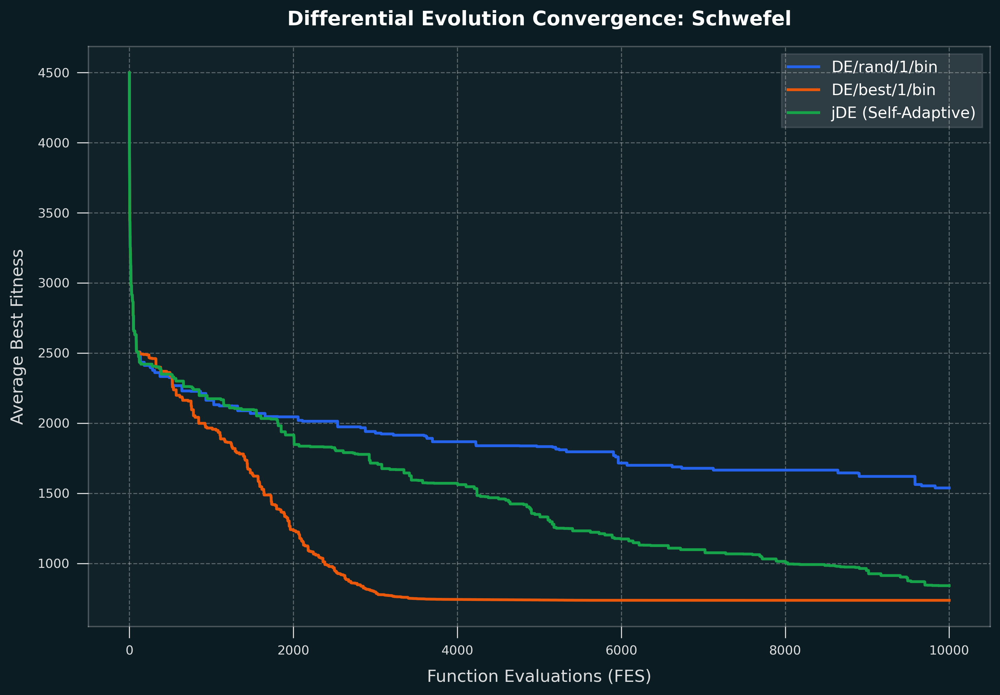
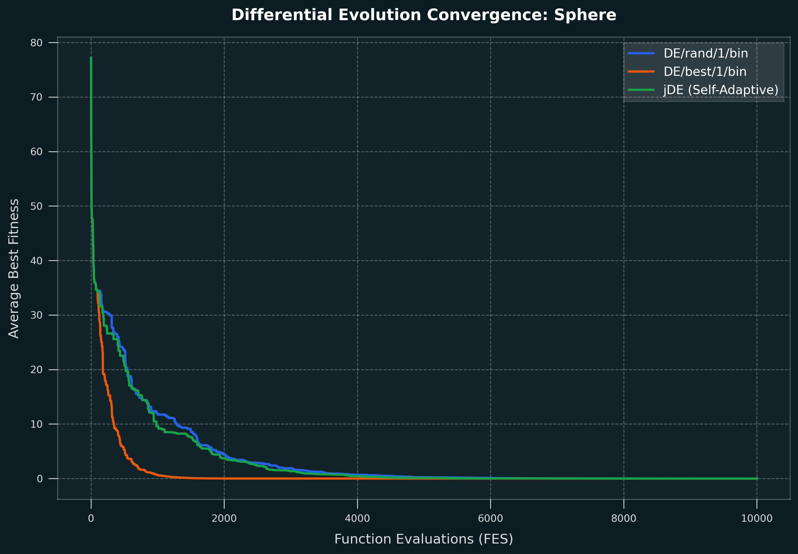
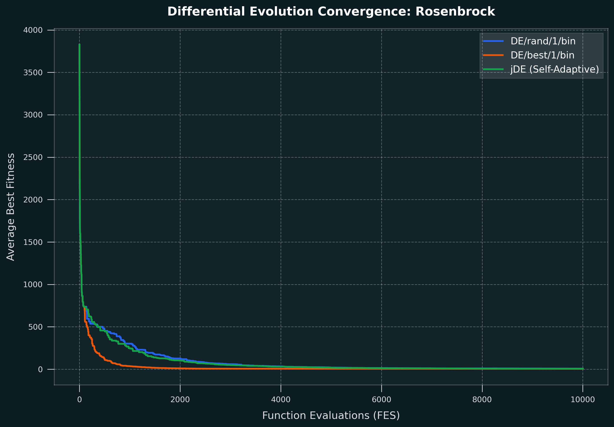

# Differential Evolution (DE)

This project implements Differential Evolution (DE) for continuous optimization problems. It compares three key variants of Differential Evolution (**DE/rand/1/bin**, **DE/best/1/bin**, and **jDE** [Self-Adaptive Differential Evolution]) on the **Schwefel**, **Sphere**, and **Rosenbrock** benchmark functions in 10 dimensions.

The implementation uses:

- DE mutation strategies: Rand/1 ($v_i = x_{r1} + F(x_{r2} - x_{r3})$) and Best/1 ($v_i = x_{\text{best}} + F(x_{r1} - x_{r2})$)
- Self-adaptive parameter control: jDE with dynamically evolving $F$ and $CR$ per individual
- Binomial crossover with guaranteed mutated coordinate ($j_{\text{rand}}$)
- Box-constraint boundary handling (clamping to search bounds)
- One-to-one greedy selection (minimization)
- Reproducible pseudo-random seeds
- Average best-so-far convergence plots
- Summary statistics over multiple independent runs

## Project Structure

```text
.
├── main.py                          # Main experiment runner and Differential Evolution
├── results.ipynb                    # Documented experimental results
├── results.json                     # Saved experiment results
├── modules/
│   ├── __init__.py                  # Package exports and function mapping
│   ├── benchmark_functions.py       # Benchmark optimization functions
│   ├── cli.py                       # Command-line argument parsing and validation
│   ├── de_engine.py                 # Core DE engine with Rand/1, Best/1, and jDE variants
│   └── visualization.py             # Convergence plot generation
└── img/
    └── convergence/
        ├── convergence_schwefel.png    # Schwefel average convergence plot
        ├── convergence_sphere.png      # Sphere average convergence plot
        └── convergence_rosenbrock.png  # Rosenbrock average convergence plot
```

## Benchmark Problems

All benchmark problems are formulated as minimization tasks: `min f(x)`.

Benchmark functions available in `modules/benchmark_functions.py`: **Schwefel**, **Sphere**, **Rosenbrock**, **Rastrigin**, **Ackley**, **Zakharov**, and **Michalewicz**.

## Differential Evolution Algorithm

Each run starts with a randomly generated population of $NP$ continuous vectors uniformly sampled within the domain bounds $[lo, hi]^D$. Every subsequent generation progresses as follows:

1. For each target vector $x_i$ in the population:
   - **Control parameter determination:**
     - For **Rand/1** and **Best/1**, static control parameters $F$ and $CR$ are applied.
     - For **jDE**, candidate parameters $F_i'$ and $CR_i'$ are stochastically mutated with probabilities $\tau_1 = \tau_2 = 0.1$:
       $$F_i' = \begin{cases} F_l + \text{rand}_1 \cdot (F_u - F_l) & \text{if } \text{rand}_2 < \tau_1 \\ F_i & \text{otherwise} \end{cases}$$
       $$CR_i' = \begin{cases} CR_l + \text{rand}_3 \cdot (CR_u - CR_l) & \text{if } \text{rand}_4 < \tau_2 \\ CR_i & \text{otherwise} \end{cases}$$
   - **Mutation:** A mutant vector $v_i$ is generated using the specified strategy:
     - **Rand/1:** $v_i = x_{r1} + F \cdot (x_{r2} - x_{r3})$
     - **Best/1:** $v_i = x_{\text{best}} + F \cdot (x_{r1} - x_{r2})$
   - **Binomial Crossover:** A trial vector $u_i$ is formed by crossing $x_i$ with $v_i$:
     $$u_{i,j} = \begin{cases} v_{i,j} & \text{if } \text{rand}_j(0, 1) \le CR \text{ or } j = j_{\text{rand}} \\ x_{i,j} & \text{otherwise} \end{cases}$$
     where $j_{\text{rand}} \in \{0, \dots, D-1\}$ guarantees that at least one coordinate comes from the mutant vector.
   - **Boundary Handling:** Any trial vector coordinate exceeding the domain bounds is clamped: $u_{i,j} = \mathrm{clip}(u_{i,j}, lo, hi)$.
2. **Evaluation & Greedy Selection:** The trial vector $u_i$ is evaluated. If $f(u_i) \le f(x_i)$, the trial vector replaces the target vector in the next generation:
   - For **jDE**, successful parameters $F_i'$ and $CR_i'$ are also accepted: $F_i \leftarrow F_i'$, $CR_i \leftarrow CR_i'$. If rejected, previous parameters $F_i$ and $CR_i$ are preserved.
3. The best-so-far fitness across the population is updated and logged after each objective evaluation.

The default configuration follows the assignment recommendations:

| Parameter | Default |
|---|---:|
| Population size ($NP$) | 100 |
| Scale factor ($F$) | 0.50 |
| Crossover ratio ($CR$) | 0.80 |
| jDE initial $F$ | 0.50 |
| jDE initial $CR$ | 0.90 |
| jDE learning rates ($\tau_1, \tau_2$) | 0.10, 0.10 |
| jDE $F$ range | [0.1, 0.9] |
| jDE $CR$ range | [0.0, 1.0] |
| Crossover strategy | Binomial |
| Selection | Greedy one-to-one |
| Independent runs | 10 |
| Dimensions | 10 |
| Evaluation budget | 10,000 FES |
| Random seed | 42 |

### Algorithm Variants

- **DE/rand/1/bin** (`rand_1`): Standard Differential Evolution with random base vector: $v_i = x_{r1} + F(x_{r2} - x_{r3})$. Mutually distinct donor indices $r_1, r_2, r_3 \ne i$ preserve diversity and explore without directional bias.
- **DE/best/1/bin** (`best_1`): Exploitative mutation centered at the current global best: $v_i = x_{\text{best}} + F(x_{r1} - x_{r2})$. Mutually distinct donor indices $r_1, r_2 \ne i$. Excellent for accelerating convergence along convex basins and valleys.
- **jDE (Self-Adaptive)** (`jde`): Self-adaptive parameter control where control parameters $F_i$ and $CR_i$ evolve alongside candidate solutions using Rand/1 mutation. Successful parameters are rewarded through survival selection, eliminating manual tuning across different problem landscapes.

## Usage

### Run the default experiment

```bash
python main.py
```

The default command runs all 3 variants on Schwefel, Sphere, and Rosenbrock (10D, 10,000 FES, 10 runs), prints summary statistics, and generates convergence plots.

### Save results to JSON

```bash
python main.py --save-results
```

This writes the detailed experiment data to `results.json`, including:

- Best, worst, mean, median, and standard deviation for each configuration
- The average best-so-far convergence trace over 10 independent runs

### Run specific functions or variants

```bash
python main.py -f sphere rosenbrock
python main.py -v rand_1 best_1
python main.py -f rastrigin ackley -v rand_1 jde
```

### Run custom parameters

```bash
python main.py -d 10 -n 20 --max-fes 15000 --population-size 150 -F 0.6 --cr 0.85
```

## Available CLI Arguments

- `-f, --functions` - Benchmark functions to test: `schwefel`, `sphere`, `rosenbrock`, `rastrigin`, `ackley`, `zakharov`, `michalewicz`, or `all`. Default: `schwefel sphere rosenbrock`
- `-v, --variants` - DE variants to test: `rand_1`, `best_1`, `jde`, or `all`. Default: `all`
- `-n, --n-runs` - Number of independent runs per configuration. Default: `10`
- `-d, --dimension` - Search space dimensionality. Default: `10`
- `--max-fes` - Maximum objective evaluations per run. Default: `10000`
- `-s, --seed` - Base random seed. Default: `42`
- `--population-size` - Number of vectors in the population ($NP$). Default: `100`
- `-F, --f` - Mutation scale factor $F$ for Rand/1 and Best/1, and initial $F$ for jDE. Default: `0.5`
- `--cr` - Crossover probability $CR$ for Rand/1 and Best/1. Default: `0.8`
- `--jde-cr` - Initial crossover probability $CR$ for jDE. Default: `0.9`
- `--tau1` - Probability of scale factor adaptation in jDE. Default: `0.1`
- `--tau2` - Probability of crossover rate adaptation in jDE. Default: `0.1`
- `--f-lower` - Lower bound for adapted $F$ in jDE. Default: `0.1`
- `--f-upper` - Upper bound for adapted $F$ in jDE. Default: `0.9`
- `--cr-lower` - Lower bound for adapted $CR$ in jDE. Default: `0.0`
- `--cr-upper` - Upper bound for adapted $CR$ in jDE. Default: `1.0`
- `--no-plots` - Skip generating convergence plots
- `--save-results` - Save detailed results to `results.json`

Run the following command to display all arguments and their defaults:

```bash
python main.py -h
```

## Example Output

The following output was produced using the default configuration:

```text
schwefel      | DE/rand/1/bin             | best=1177.8664 | worst=1792.6203 | mean=1537.7096 | median=1563.9541 | stddev=173.7180
schwefel      | DE/best/1/bin             | best=355.3151 | worst=1106.9881 | mean=736.3458 | median=713.6980 | stddev=208.8142
schwefel      | jDE (Self-Adaptive)       | best=567.0384 | worst=1021.3228 | mean=841.0143 | median=863.4108 | stddev=146.4675
sphere        | DE/rand/1/bin             | best=0.0009 | worst=0.0029 | mean=0.0018 | median=0.0018 | stddev=0.0006
sphere        | DE/best/1/bin             | best=0.0000 | worst=0.0000 | mean=0.0000 | median=0.0000 | stddev=0.0000
sphere        | jDE (Self-Adaptive)       | best=0.0001 | worst=0.0007 | mean=0.0003 | median=0.0003 | stddev=0.0002
rosenbrock    | DE/rand/1/bin             | best=6.6754 | worst=8.0979 | mean=7.3326 | median=7.2710 | stddev=0.4615
rosenbrock    | DE/best/1/bin             | best=0.1605 | worst=8.1744 | mean=4.5947 | median=5.4149 | stddev=3.2478
rosenbrock    | jDE (Self-Adaptive)       | best=6.3863 | worst=7.7808 | mean=7.1446 | median=7.2777 | stddev=0.5130
Saved: results.json
Saved: img\convergence\convergence_schwefel.png
Saved: img\convergence\convergence_sphere.png
Saved: img\convergence\convergence_rosenbrock.png
```

## Convergence Results

The plots show the average best-so-far fitness over the 10 independent runs. The horizontal axis is the number of function evaluations (FES), while the vertical axis is the average best fitness.

### Schwefel



### Sphere



### Rosenbrock



## Results Summary

| Function | Variant | Best | Worst | Mean | Median | Standard deviation |
|---|---|---:|---:|---:|---:|---:|
| Schwefel | DE/rand/1/bin | 1177.8664 | 1792.6203 | 1537.7096 | 1563.9541 | 173.7180 |
| Schwefel | DE/best/1/bin | 355.3151 | 1106.9881 | 736.3458 | 713.6980 | 208.8142 |
| Schwefel | jDE (Self-Adaptive) | 567.0384 | 1021.3228 | 841.0143 | 863.4108 | 146.4675 |
| Sphere | DE/rand/1/bin | 0.0009 | 0.0029 | 0.0018 | 0.0018 | 0.0006 |
| Sphere | DE/best/1/bin | 0.0000 | 0.0000 | 0.0000 | 0.0000 | 0.0000 |
| Sphere | jDE (Self-Adaptive) | 0.0001 | 0.0007 | 0.0003 | 0.0003 | 0.0002 |
| Rosenbrock | DE/rand/1/bin | 6.6754 | 8.0979 | 7.3326 | 7.2710 | 0.4615 |
| Rosenbrock | DE/best/1/bin | 0.1605 | 8.1744 | 4.5947 | 5.4149 | 3.2478 |
| Rosenbrock | jDE (Self-Adaptive) | 6.3863 | 7.7808 | 7.1446 | 7.2777 | 0.5130 |

The experimental results illustrate the core trade-offs between exploitation, exploration, and parameter adaptation. **DE/best/1/bin** provides aggressive exploitation, achieving near-perfect convergence on Sphere ($< 10^{-11}$) and tracing Rosenbrock's valley floor down to 0.1605, though its greediness produces higher variance on deceptive landscapes like Schwefel. In contrast, **DE/rand/1/bin** prioritizes uniform exploration through unbiased random base vectors, preserving population diversity and avoiding premature stagnation at the cost of a slower convergence rate. **jDE** self-adapts $F$ and $CR$ per individual through greedy selection, reliably outperforming static Rand/1 across all benchmarks while delivering lower variance and greater stability than Best/1 on complex landscapes without requiring manual parameter tuning.
