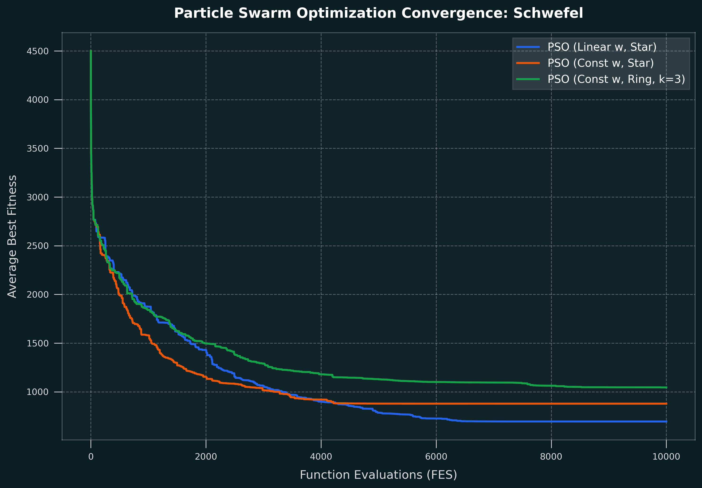
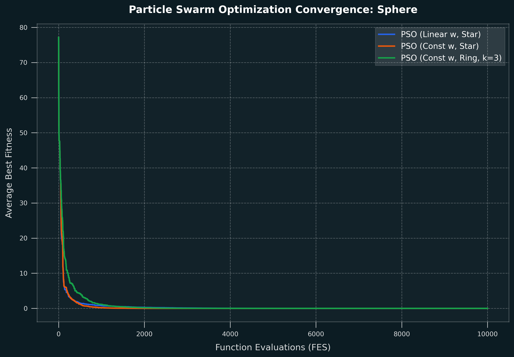
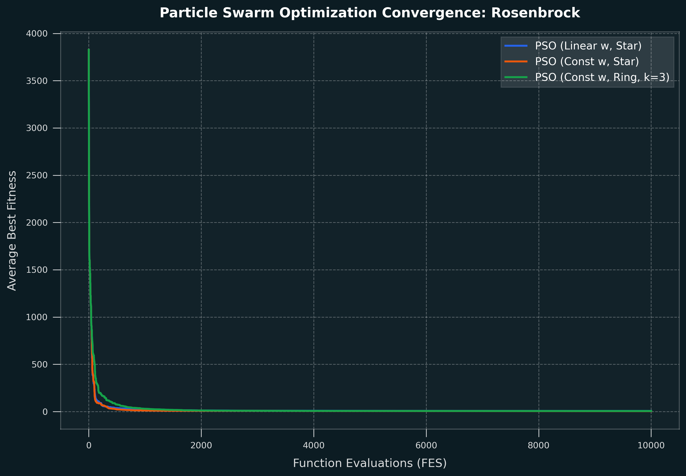

# Particle Swarm Optimization (PSO)

This project implements Particle Swarm Optimization (PSO) for continuous optimization problems. It compares three key variants of Particle Swarm Optimization (**PSO with Linearly Decreasing Inertia Weight [Star Topology]**, **PSO with Constant Inertia Weight [Star Topology]**, and **PSO with Constant Inertia Weight [Ring Topology, neighborhood size 3]**) on the **Schwefel**, **Sphere**, and **Rosenbrock** benchmark functions in 10 dimensions.

The implementation uses:

- Dynamic and static inertia weight schemes ($w = 0.8 \rightarrow 0.3$ and $w = 0.7$)
- Cognitive and social acceleration coefficients ($c_1 = c_2 = 2.0$ and $c_1 = c_2 = 1.49618$)
- Swarm communication topologies: Global Star (gbest) and Local Ring with neighborhood size $k=3$ (lbest)
- Velocity clamping: maximum velocity constrained to $v_{\max} = 0.2 \times \text{Range}$
- Boundary handling: particles are free to fly outside the search boundaries, but their fitness is never evaluated outside bounds (conserving evaluation budget)
- Evaluation budget (MAXFES) stopping criterion
- Reproducible pseudo-random seeds
- Average best-so-far convergence plots
- Summary statistics over multiple independent runs

## Project Structure

```text
.
├── main.py                          # Main experiment runner for Particle Swarm Optimization
├── results.ipynb                    # Documented experimental results
├── results.json                     # Saved experiment results
├── modules/
│   ├── __init__.py                  # Package exports and function mapping
│   ├── benchmark_functions.py       # Benchmark optimization functions
│   ├── cli.py                       # Command-line argument parsing and validation
│   ├── pso_engine.py                # Core PSO engine with Linear Star, Const Star, and Const Ring variants
│   └── visualization.py             # Convergence plot generation
└── img/
    └── convergence/
        ├── convergence_schwefel.png    # Schwefel average convergence plot
        ├── convergence_sphere.png      # Sphere average convergence plot
        └── convergence_rosenbrock.png  # Rosenbrock average convergence plot
```

## Benchmark Problems

All benchmark problems are formulated as minimization tasks: `min f(x)`.

Benchmark functions available in `modules/benchmark_functions.py`: **Schwefel**, **Sphere**, **Rosenbrock**, **Rastrigin**, **Ackley**, **Zakharov**, and **Michalewicz**.

## Particle Swarm Optimization Algorithm

Each run starts with a randomly generated swarm of $NP$ particles uniformly sampled within the domain bounds $[lo, hi]^D$, and initial velocities uniformly sampled within $[-v_{\max}, v_{\max}]^D$. Every subsequent iteration progresses as follows:

1. **Velocity and Position Update:**
   - For each particle $i$ in the swarm:
     - The velocity vector $\mathbf{v}_i$ is updated across each dimension $d \in \{0, \dots, D-1\}$:
       $$v_{i, d}^{(t+1)} = w \cdot v_{i, d}^{(t)} + c_1 \cdot r_{1, i, d} \cdot (p_{i, d} - x_{i, d}^{(t)}) + c_2 \cdot r_{2, i, d} \cdot (g_{i, d} - x_{i, d}^{(t)})$$
       where:
       - $w$ is the inertia weight controlling momentum retention.
       - $c_1, c_2$ are cognitive and social acceleration coefficients.
       - $r_{1, i, d}, r_{2, i, d} \sim U(0, 1)$ are independent stochastic multipliers per dimension.
       - $\mathbf{p}_i$ is particle $i$'s personal best position found so far.
       - $\mathbf{g}_i$ is the social attractor position:
         - In **Star topology (gbest)**, $\mathbf{g}_i = \mathbf{g}^*$ is the swarm's global best personal best: $\mathbf{g}^* = \mathbf{p}_{\arg\min_k f(\mathbf{p}_k)}$.
         - In **Ring topology (lbest, $k=3$)**, $\mathbf{g}_i = \mathbf{l}_i^*$ is the best personal best within the local neighborhood:
           $$\mathbf{l}_i^* = \mathbf{p}_{k^*}, \quad k^* = \arg\min_{k \in \{(i-1)\%NP, i, (i+1)\%NP\}} f(\mathbf{p}_k)$$
     - **Velocity Clamping:** The velocity is bounded per dimension to $[-v_{\max}, v_{\max}]$:
       $$v_{i, d}^{(t+1)} = \mathrm{clip}\left(v_{i, d}^{(t+1)}, -v_{\max}, v_{\max}\right), \quad v_{\max} = 0.2 \times (hi - lo)$$
     - **Position Update:** The particle position updates by applying the clamped velocity:
       $$\mathbf{x}_i^{(t+1)} = \mathbf{x}_i^{(t)} + \mathbf{v}_i^{(t+1)}$$
       Particles are permitted to fly outside the search domain $[lo, hi]^D$ without position clamping.

2. **Boundary Handling & Fitness Evaluation:**
   - If particle $\mathbf{x}_i^{(t+1)}$ lies entirely within the search bounds ($lo \le x_{i, d}^{(t+1)} \le hi$ for all $d$):
     - The objective function value $f(\mathbf{x}_i^{(t+1)})$ is evaluated, consuming 1 FES.
     - If $f(\mathbf{x}_i^{(t+1)}) < f(\mathbf{p}_i)$, the personal best is updated: $\mathbf{p}_i \leftarrow \mathbf{x}_i^{(t+1)}$ and $f(\mathbf{p}_i) \leftarrow f(\mathbf{x}_i^{(t+1)})$.
     - If $f(\mathbf{x}_i^{(t+1)}) < f_{\text{best}}$, the swarm global best is updated.
   - If particle $\mathbf{x}_i^{(t+1)}$ is outside the search bounds:
     - Its fitness is **not evaluated** and no FES is consumed.
     - The personal best $\mathbf{p}_i$ remains unchanged (guaranteed to stay inside the feasible search space).
     - In subsequent iterations, the cognitive term $(\mathbf{p}_i - \mathbf{x}_i)$ and social term $(\mathbf{g}_i - \mathbf{x}_i)$ pull the particle back towards the interior search space.

3. The best-so-far fitness across the swarm is recorded after each objective evaluation.

The default configuration follows the assignment recommendations:

| Parameter | Default |
|---|---:|
| Swarm population size ($NP$) | 50 |
| Linear $w$ range ($w_{\text{start}} \rightarrow w_{\text{end}}$) | $0.8 \rightarrow 0.3$ |
| Linear variant acceleration ($c_1, c_2$) | 2.0, 2.0 |
| Constant inertia weight ($w$) | 0.70 |
| Constant variant acceleration ($c_1, c_2$) | 1.49618, 1.49618 |
| Maximum velocity ratio ($v_{\max} / \text{Range}$) | 0.20 |
| Ring neighborhood size ($k$) | 3 |
| Stopping criterion | 10,000 FES |
| Dimensions ($D$) | 10 |
| Independent runs | 10 |
| Random seed | 42 |

### Algorithm Variants

- **PSO with Linearly Decreasing Inertia Weight (Star Topology)** (`linear_star`): Linearly decreases the inertia weight from $w = 0.8$ at $\text{FES} = 0$ down to $w = 0.3$ at $\text{FES} = \text{MAXFES}$, with acceleration coefficients $c_1 = c_2 = 2.0$. It employs a global star communication topology where every particle is immediately informed by the swarm's global best position $\mathbf{g}^*$. It prioritizes wide exploration during the early search stages and transitions into fine local exploitation as $w$ decreases.
- **PSO with Constant Inertia Weight (Star Topology)** (`const_star`): Applies a constant inertia weight $w = 0.70$ and constriction-derived acceleration coefficients $c_1 = c_2 = 1.49618$ under a global star topology. It provides a steady, aggressive convergence trajectory that excels on convex landscapes and valley floors.
- **PSO with Constant Inertia Weight (Ring Topology, $k=3$)** (`const_ring`): Utilizes the same constant parameters $w = 0.70$ and $c_1 = c_2 = 1.49618$, but restricts social communication to a 1D ring neighborhood of size 3 (the particle itself and its immediate left and right neighbors modulo $NP$). By decelerating information diffusion across the swarm, this topology sustains population diversity and mitigates premature convergence on deceptive multimodal landscapes.

## Usage

### Run the default experiment

```bash
python main.py
```

The default command runs all 3 variants on Schwefel, Sphere, and Rosenbrock (10D, 10,000 FES, 10 runs, population size 50), prints summary statistics, and generates convergence plots.

### Save results to JSON

```bash
python main.py --save-results
```

This writes the detailed experiment data to `results.json`, including:

- Best, worst, mean, median, and standard deviation for each configuration
- The average best-so-far convergence trace over 10 independent runs

### Run specific functions or variants

```bash
python main.py -f sphere rosenbrock
python main.py -v linear_star const_star
python main.py -f rastrigin ackley -v linear_star const_ring
```

### Run custom parameters

```bash
python main.py -d 10 -n 20 --max-fes 15000 --population-size 40 --w-start 0.9 --w-end 0.4
```

## Available CLI Arguments

- `-f, --functions` - Benchmark functions to test: `schwefel`, `sphere`, `rosenbrock`, `rastrigin`, `ackley`, `zakharov`, `michalewicz`, or `all`. Default: `schwefel sphere rosenbrock`
- `-v, --variants` - PSO variants to test: `linear_star`, `const_star`, `const_ring`, or `all`. Default: `all`
- `-n, --n-runs` - Number of independent runs per configuration. Default: `10`
- `-d, --dimension` - Search space dimensionality. Default: `10`
- `--max-fes` - Maximum objective evaluations per run. Default: `10000`
- `-s, --seed` - Base random seed. Default: `42`
- `--population-size` - Number of particles in the swarm ($NP$). Default: `50`
- `--w-start` - Starting inertia weight for linearly decreasing variant. Default: `0.8`
- `--w-end` - Ending inertia weight for linearly decreasing variant. Default: `0.3`
- `--w-const` - Inertia weight for constant inertia variants. Default: `0.7`
- `--c1-linear` - Cognitive acceleration coefficient for linear variant. Default: `2.0`
- `--c2-linear` - Social acceleration coefficient for linear variant. Default: `2.0`
- `--c1-const` - Cognitive acceleration coefficient for constant variants. Default: `1.49618`
- `--c2-const` - Social acceleration coefficient for constant variants. Default: `1.49618`
- `--v-max-ratio` - Maximum velocity ratio ($v_{\max} = \text{ratio} \times \text{Range}$). Default: `0.2`
- `--neighborhood-size` - Neighborhood size for ring topology ($k$, odd integer $\ge 3$). Default: `3`
- `--no-plots` - Skip generating convergence plots
- `--save-results` - Save detailed results to `results.json`

Run the following command to display all arguments and their defaults:

```bash
python main.py -h
```

## Example Output

The following output was produced using the default configuration:

```text
schwefel      | PSO (Linear w, Star)         | best=355.3151 | worst=1105.4382 | mean=694.8424 | median=631.6740 | stddev=229.6038
schwefel      | PSO (Const w, Star)          | best=454.0165 | worst=1322.6108 | mean=878.4314 | median=937.6478 | stddev=341.8195
schwefel      | PSO (Const w, Ring, k=3)     | best=690.9350 | worst=1362.7079 | mean=1044.8584 | median=1095.9243 | stddev=185.4661
sphere        | PSO (Linear w, Star)         | best=0.0000 | worst=0.0000 | mean=0.0000 | median=0.0000 | stddev=0.0000
sphere        | PSO (Const w, Star)          | best=0.0000 | worst=0.0000 | mean=0.0000 | median=0.0000 | stddev=0.0000
sphere        | PSO (Const w, Ring, k=3)     | best=0.0000 | worst=0.0000 | mean=0.0000 | median=0.0000 | stddev=0.0000
rosenbrock    | PSO (Linear w, Star)         | best=4.4067 | worst=9.5044 | mean=6.7609 | median=6.0161 | stddev=1.7821
rosenbrock    | PSO (Const w, Star)          | best=3.9872 | worst=5.0802 | mean=4.3700 | median=4.3021 | stddev=0.3141
rosenbrock    | PSO (Const w, Ring, k=3)     | best=3.1473 | worst=6.8324 | mean=5.8152 | median=6.2450 | stddev=1.1565
Saved: results.json
Saved: img\convergence\convergence_schwefel.png
Saved: img\convergence\convergence_sphere.png
Saved: img\convergence\convergence_rosenbrock.png
```

## Convergence Results

The plots show the average best-so-far fitness over the 10 independent runs. The horizontal axis is the number of function evaluations (FES), while the vertical axis is the average best fitness.

### Schwefel



### Sphere



### Rosenbrock



## Results Summary

| Function | Variant | Best | Worst | Mean | Median | Standard deviation |
|---|---|---:|---:|---:|---:|---:|
| Schwefel | PSO (Linear w, Star) | 355.3151 | 1105.4382 | 694.8424 | 631.6740 | 229.6038 |
| Schwefel | PSO (Const w, Star) | 454.0165 | 1322.6108 | 878.4314 | 937.6478 | 341.8195 |
| Schwefel | PSO (Const w, Ring, k=3) | 690.9350 | 1362.7079 | 1044.8584 | 1095.9243 | 185.4661 |
| Sphere | PSO (Linear w, Star) | 0.0000 | 0.0000 | 0.0000 | 0.0000 | 0.0000 |
| Sphere | PSO (Const w, Star) | 0.0000 | 0.0000 | 0.0000 | 0.0000 | 0.0000 |
| Sphere | PSO (Const w, Ring, k=3) | 0.0000 | 0.0000 | 0.0000 | 0.0000 | 0.0000 |
| Rosenbrock | PSO (Linear w, Star) | 4.4067 | 9.5044 | 6.7609 | 6.0161 | 1.7821 |
| Rosenbrock | PSO (Const w, Star) | 3.9872 | 5.0802 | 4.3700 | 4.3021 | 0.3141 |
| Rosenbrock | PSO (Const w, Ring, k=3) | 3.1473 | 6.8324 | 5.8152 | 6.2450 | 1.1565 |

The experiment's results illustrate the core trade-offs between exploration, exploitation, and population diversity. On Schwefel, **Linear w with a star topology** achieved the best mean ($694.8424$) and best result ($355.3151$), while the ring topology was more stable, giving the lowest standard deviation ($185.4661$). All variants converged near the global minimum on Sphere ($<10^{-25}$). On Rosenbrock, **constant-w star PSO** was the most consistent ($f_{\text{mean}}=4.3700$, $\sigma=0.3141$), whereas **constant-w ring PSO** produced the best individual run ($3.1473$). Boundary flights were allowed without objective evaluation outside the domain, saving over 1,000 evaluations on Schwefel and allowing particles to be pulled back into the feasible region.
